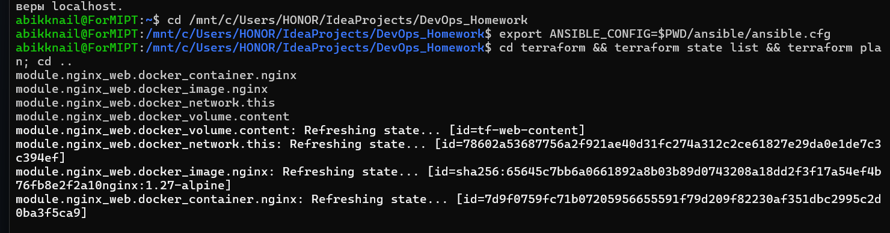
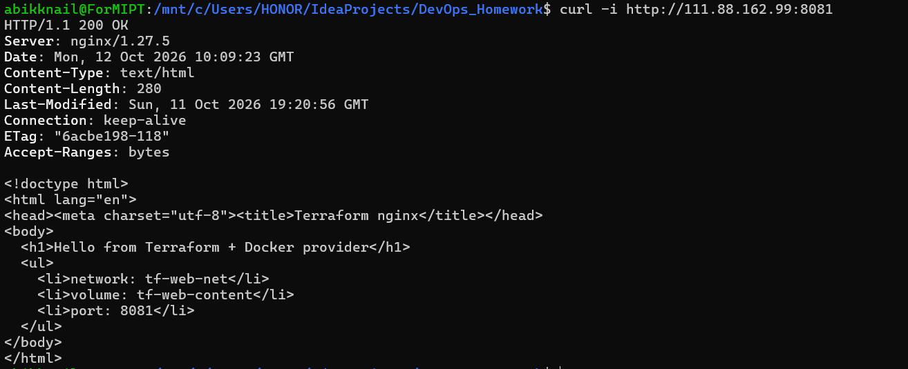
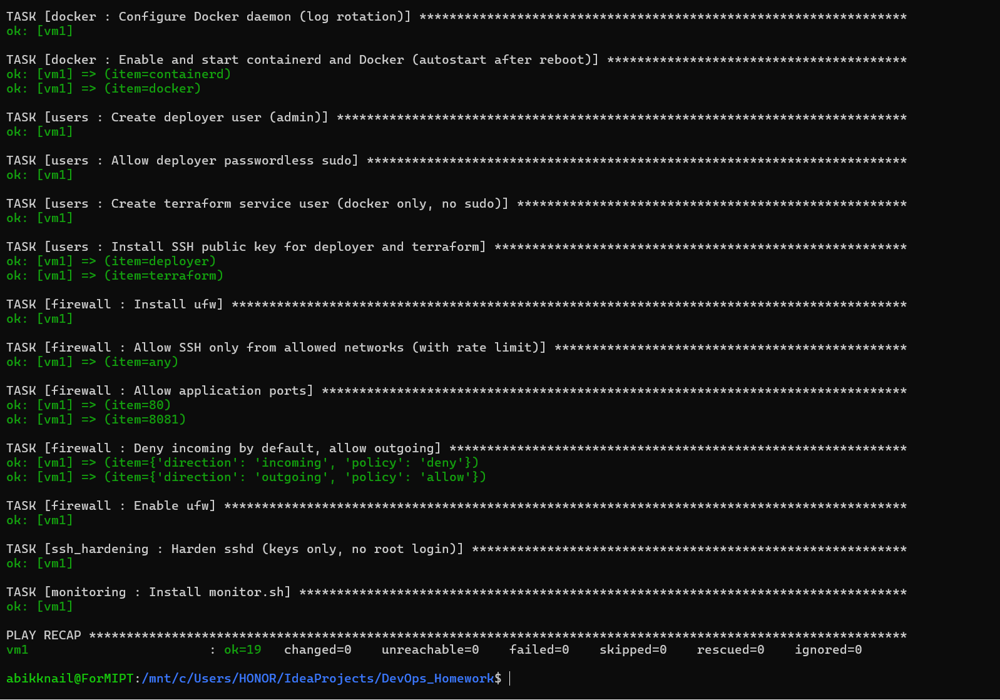
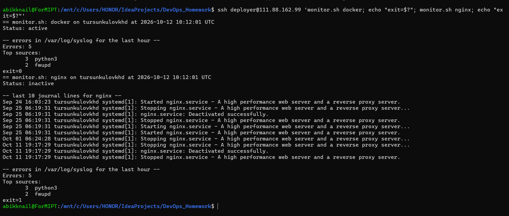
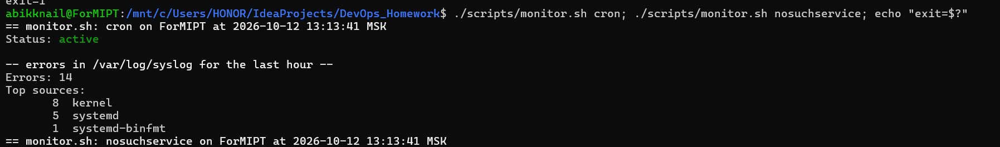
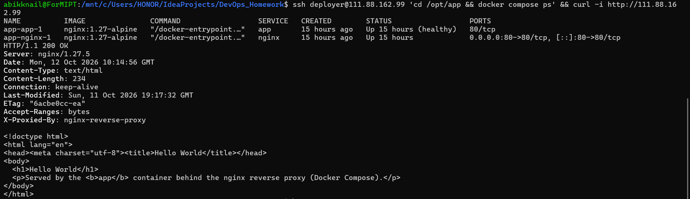
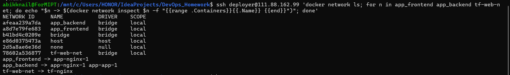

# DevOps_Homework
Репозиторий Турсункулова Хабибулло Дилшодовича (Б13-402) для сдачи домашних заданий по DevOps

---

# ДЗ #1 — Фундамент DevOps-инфраструктуры

Terraform + Ansible + Docker + Bash: подготовка «чистого» хоста под контейнеры,
инфраструктура как код и утилита мониторинга.

## Содержание
- [Архитектура](#архитектура)
- [Структура репозитория](#структура-репозитория)
- [Требования](#требования)
- [Запуск](#запуск)
- [Результаты](#результаты)
- [Архитектурные решения](#архитектурные-решения)
- [Проблемы и как они решались](#проблемы-и-как-они-решались)
- [Ответы на вопросы для самопроверки](#ответы-на-вопросы-для-самопроверки)

## Архитектура

Хост — учебная VM в облаке MWS (Ubuntu 24.04, `111.88.162.99`).
По дополнению преподавателя Terraform использует провайдер
[`kreuzwerker/docker`](https://github.com/kreuzwerker/terraform-provider-docker),
поэтому порядок такой: **сначала Ansible ставит Docker на VM, затем Terraform
создаёт Docker-объекты на этой VM**.

```text
 WSL (рабочая машина)                                VM 111.88.162.99 (Ubuntu 24.04)
 ─────────────────────                               ──────────────────────────────────────────────
 ansible-playbook ── SSH (student/deployer) ──────▶  Docker Engine + Compose, ufw, users, sshd
                                                     │
 terraform ───────── SSH (terraform) ─────────────▶  │ docker system dial-stdio
                                                     │
                                                     ├─ сеть tf-web-net (172.30.0.0/24)   ◀─ Terraform
                                                     │    └─ tf-nginx  :8081 → 80
                                                     │         └─ том tf-web-content → /usr/share/nginx/html
                                                     │
                                                     ├─ сеть app_frontend                 ◀─ Compose (/opt/app)
                                                     │    └─ app-nginx-1 (reverse proxy) :80 → 80
                                                     └─ сеть app_backend (internal)
                                                          ├─ app-nginx-1
                                                          └─ app-app-1 (nginx, "Hello World", порт не опубликован)

 ufw (аналог Security Group): входящие deny по умолчанию; 22/tcp limit, 80/tcp, 8081/tcp allow
```

## Структура репозитория

```text
.
├── ansible/
│   ├── ansible.cfg
│   ├── inventory.ini             # IP VM
│   ├── group_vars/all.yml        # все параметры: пользователи, порты, CIDR для SSH
│   ├── setup_host.yml            # Этап 3: подготовка хоста
│   ├── deploy_app.yml            # Этап 5: Compose-окружение в /opt/app
│   └── roles/
│       ├── docker/               # репозиторий Docker, docker-ce, compose-plugin, автозапуск
│       ├── users/                # deployer (sudo NOPASSWD), terraform (только docker)
│       ├── firewall/             # ufw
│       ├── ssh_hardening/        # вход только по ключу, без root
│       ├── monitoring/           # monitor.sh → /usr/local/bin
│       └── app/                  # docker compose up в /opt/app
├── terraform/
│   ├── versions.tf               # версии, local backend
│   ├── providers.tf              # docker-провайдер через SSH
│   ├── variables.tf / terraform.tfvars
│   ├── main.tf                   # вызов модуля
│   ├── outputs.tf
│   ├── templates/index.html.tftpl
│   └── modules/nginx_web/        # сеть + том + образ + контейнер
├── compose/                      # то, что попадает в /opt/app на VM
│   ├── docker-compose.yml
│   ├── nginx/default.conf        # конфиг reverse proxy
│   └── app/index.html            # "Hello World"
└── scripts/
    └── monitor.sh                # Этап 4
```

## Требования

На рабочей машине (проверено в WSL Ubuntu 24.04):

| Инструмент | Версия | Примечание |
|---|---|---|
| Ansible | core 2.16 | коллекции `community.docker` ≥ 3.6, `community.general`, `ansible.posix` |
| Terraform | 1.16.5 | из РФ: зеркало `mirror.selectel.ru/3rd-party/hashicorp-releases/` |
| SSH-ключ | `~/.ssh/id_ed25519` | ключ уже должен быть в `authorized_keys` пользователя `student` на VM |

Реестр Terraform из РФ недоступен, поэтому провайдеры ставятся через зеркало
Яндекса — `~/.terraformrc`:

```hcl
provider_installation {
  network_mirror {
    url     = "https://terraform-mirror.yandexcloud.net/"
    include = ["registry.terraform.io/*/*"]
  }
  direct {
    exclude = ["registry.terraform.io/*/*"]
  }
}
```

## Запуск

```bash
git clone https://github.com/TursunkulovKhabib/DevOps_Homework.git
cd DevOps_Homework
```

> Если репозиторий лежит на диске Windows (`/mnt/c/...`), Ansible игнорирует
> `ansible.cfg` в world-writable каталоге — укажите его явно:
> `export ANSIBLE_CONFIG=$PWD/ansible/ansible.cfg`.

### 1. Ansible — подготовка хоста (Этап 3)

```bash
cd ansible
ansible-playbook setup_host.yml           # первый прогон: changed > 0
ansible-playbook setup_host.yml           # второй прогон: changed=0 (идемпотентность)
```

Ограничить SSH только своим IP (аналог правила Security Group):

```bash
ansible-playbook setup_host.yml -e '{"ssh_allowed_cidrs": ["<ВАШ_IP>/32"]}'
```

После первого прогона можно работать под `deployer`: `-e ansible_user=deployer`.

### 2. Terraform — сеть, том и nginx (Этап 2)

```bash
cd ../terraform
terraform init
terraform fmt -check -recursive && terraform validate
terraform plan
terraform apply
terraform state list
curl -i http://111.88.162.99:8081
```

Удалить: `terraform destroy` (образ остаётся на хосте из-за `keep_locally = true`).

### 3. Docker Compose (Этап 5)

```bash
cd ../ansible
ansible-playbook deploy_app.yml
curl -i http://111.88.162.99
```

Вручную на VM: `cd /opt/app && docker compose ps`.

### 4. Мониторинг (Этап 4)

```bash
./scripts/monitor.sh docker                 # локально
ssh deployer@111.88.162.99 monitor.sh docker  # на VM (скрипт доставлен Ansible)
```

| Код выхода | Значение |
|---|---|
| 0 | сервис `active` |
| 1 | сервис не активен — печатаются последние 10 строк `journalctl` |
| 2 | неверный аргумент / нет нужных утилит |
| 3 | сервис не найден |

## Результаты

> Скриншоты и фактический вывод команд с VM (11–12.10.2026).

### `terraform apply` и `terraform state list`



```text
$ terraform apply
module.nginx_web.docker_volume.content: Creation complete after 0s [id=tf-web-content]
module.nginx_web.docker_image.nginx: Creation complete after 0s [id=sha256:65645c7bb6a0...nginx:1.27-alpine]
module.nginx_web.docker_network.this: Creation complete after 2s [id=78602a536877...]
module.nginx_web.docker_container.nginx: Creation complete after 1s [id=7d9f0759fc71...]

Apply complete! Resources: 4 added, 0 changed, 0 destroyed.

Outputs:
container_name = "tf-nginx"
url = "http://111.88.162.99:8081"
volume_name = "tf-web-content"

$ terraform state list
module.nginx_web.docker_container.nginx
module.nginx_web.docker_image.nginx
module.nginx_web.docker_network.this
module.nginx_web.docker_volume.content

$ terraform plan
No changes. Your infrastructure matches the configuration.
```

### `curl -i` к nginx из Terraform (нестандартный порт 8081)



```text
$ curl -i http://111.88.162.99:8081
HTTP/1.1 200 OK
Server: nginx/1.27.5
Content-Type: text/html
Content-Length: 280

<!doctype html>
...
  <h1>Hello from Terraform + Docker provider</h1>
  <ul>
    <li>network: tf-web-net</li>
    <li>volume: tf-web-content</li>
    <li>port: 8081</li>
  </ul>
```

### Ansible — второй прогон (идемпотентность)



```text
$ ansible-playbook setup_host.yml
...
TASK [docker : Install Docker Engine and Compose plugin] ***********************
ok: [vm1]
TASK [docker : Enable and start containerd and Docker (autostart after reboot)] ***
ok: [vm1] => (item=containerd)
ok: [vm1] => (item=docker)
TASK [users : Create deployer user (admin)] ************************************
ok: [vm1]
TASK [users : Allow deployer passwordless sudo] ********************************
ok: [vm1]
TASK [firewall : Enable ufw] ***************************************************
ok: [vm1]
TASK [ssh_hardening : Harden sshd (keys only, no root login)] ******************
ok: [vm1]
...
PLAY RECAP *********************************************************************
vm1                        : ok=19   changed=0    unreachable=0    failed=0    skipped=0    rescued=0    ignored=0

$ ansible-playbook deploy_app.yml
PLAY RECAP *********************************************************************
vm1                        : ok=6    changed=0    unreachable=0    failed=0    skipped=0    rescued=0    ignored=0
```

Проверка результата:

```text
$ ssh deployer@111.88.162.99 'sudo -n whoami; docker --version; docker compose version; systemctl is-enabled docker'
root
Docker version 29.9.0, build f415da8
Docker Compose version v5.6.0
enabled

$ ssh terraform@111.88.162.99 'sudo -n true'
sudo: a password is required        # у terraform нет sudo — так и задумано

$ sudo ufw status
22/tcp                     LIMIT       Anywhere                   # ssh
80/tcp                     ALLOW       Anywhere
8081/tcp                   ALLOW       Anywhere
```

### `monitor.sh`

На VM — `docker` (active, exit=0) и остановленный `nginx` (inactive, журнал, exit=1):



Локально (WSL) — активный сервис и несуществующий (exit=3):



Текстовый вывод. На VM — сервис работает:

```text
$ monitor.sh docker
== monitor.sh: docker on tursunkulovkhd at 2026-10-11 19:21:44 UTC
Status: active

-- errors in /var/log/syslog for the last hour --
Errors: 108
Top sources:
      98  containerd
       6  python3
       4  fwupd
[exit=0]
```

На VM — сервис остановлен (системный nginx, выключенный ролью `app`):

```text
$ monitor.sh nginx
== monitor.sh: nginx on tursunkulovkhd at 2026-10-11 19:21:19 UTC
Status: inactive

-- last 10 journal lines for nginx --
...
Oct 11 19:17:29 tursunkulovkhd systemd[1]: Stopping nginx.service - A high performance web server and a reverse proxy server...
Oct 11 19:17:29 tursunkulovkhd systemd[1]: nginx.service: Deactivated successfully.
Oct 11 19:17:29 tursunkulovkhd systemd[1]: Stopped nginx.service - A high performance web server and a reverse proxy server.

-- errors in /var/log/syslog for the last hour --
Errors: 129
...
[exit=1]
```

Локально (WSL) и обработка ошибок:

```text
$ ./scripts/monitor.sh cron
== monitor.sh: cron on ForMIPT at 2026-10-11 22:21:42 MSK
Status: active

-- errors in /var/log/syslog for the last hour --
Errors: 41
Top sources:
      29  kernel
      10  systemd
       2  systemd-binfmt
[exit=0]

$ ./scripts/monitor.sh nosuchservice
ERROR: service 'nosuchservice' not found (systemctl LoadState=not-found)
[exit=3]

$ ./scripts/monitor.sh 'bad;name'
ERROR: invalid service name: 'bad;name'
[exit=2]

$ ./scripts/monitor.sh cron /tmp/empty.log
Errors: 0 (log is empty)

$ ./scripts/monitor.sh cron /nonexistent
WARN: /nonexistent does not exist (rsyslog not installed?) — skipping
```

### `docker compose ps` и `curl http://<IP>`



```text
$ cd /opt/app && docker compose ps
NAME          IMAGE               COMMAND                  SERVICE   STATUS                   PORTS
app-app-1     nginx:1.27-alpine   "/docker-entrypoint.…"   app       Up 3 minutes (healthy)   80/tcp
app-nginx-1   nginx:1.27-alpine   "/docker-entrypoint.…"   nginx     Up 3 minutes             0.0.0.0:80->80/tcp, [::]:80->80/tcp

$ curl -i http://111.88.162.99
HTTP/1.1 200 OK
Server: nginx/1.27.5
Content-Type: text/html
Content-Length: 234
X-Proxied-By: nginx-reverse-proxy

<!doctype html>
...
  <h1>Hello World</h1>
  <p>Served by the <b>app</b> container behind the nginx reverse proxy (Docker Compose).</p>
```

### Сети разделены



```text
$ docker network ls
NETWORK ID     NAME           DRIVER    SCOPE
afeaa239a7da   app_backend    bridge    local
a8d7e79fe683   app_frontend   bridge    local
78602a536877   tf-web-net     bridge    local
...

$ for n in app_frontend app_backend tf-web-net; do docker network inspect $n --format '{{range .Containers}}{{.Name}} {{end}}'; done
app_frontend   -> app-nginx-1
app_backend    -> app-nginx-1 app-app-1
tf-web-net     -> tf-nginx

$ docker run --rm -v tf-web-content:/v:ro nginx:1.27-alpine ls -l /v
-rw-r--r--    1 root     root           497 Apr 16  2025 50x.html
-rw-r--r--    1 root     root           280 Oct 11 19:20 index.html
```

## Архитектурные решения

**Terraform через docker-провайдер, а не облачный.** Так указано в дополнении к ДЗ.
Требования этапа 2 переложены на Docker-объекты:

| Требование ДЗ | Реализация |
|---|---|
| Сеть (VPC/Subnet) | `docker_network` `tf-web-net` с явной подсетью `172.30.0.0/24`, не пересекается с сетями Compose |
| VM | VM выдана курсом; Terraform создаёт на ней контейнер nginx + том |
| Security Group | ufw (роль `firewall`): deny по умолчанию, открыты только 22, 80, 8081 |
| IAM-пользователь с минимальными правами | системный пользователь `terraform`: только группа `docker`, без sudo, без пароля, вход по ключу |

**Пользователи и доступ.**
- `deployer` — администратор: `sudo` без пароля (файл в `/etc/sudoers.d/` проверяется `visudo -cf` перед записью).
- `terraform` — только для Terraform-провайдера. Оговорка: группа `docker` фактически даёт root-доступ к хосту через Docker API, поэтому пользователь отделён от `deployer` и не имеет ни sudo, ни пароля.
- sshd: `PermitRootLogin no`, `PasswordAuthentication no`. Файл `00-hardening.conf` перекрывает настройки `01-lab.conf` и `50-cloud-init.conf`, потому что в `sshd_config.d` действует первое найденное значение.
- SSH: `ufw limit` (rate-limit против перебора). По умолчанию доступ открыт отовсюду, но только по ключу: у рабочей машины динамический IP, и жёсткое правило по IP могло бы закрыть доступ к VM. Ограничение по IP включается одной переменной `ssh_allowed_cidrs`.

**Ansible.**
- Роли вместо одного файла; все параметры вынесены в `group_vars/all.yml`.
- Идемпотентность: `cache_valid_time` у `apt` (иначе `update_cache` даёт `changed` при каждом прогоне), декларативные модули (`user`, `copy`, `ufw`, `systemd_service`, `docker_compose_v2`) вместо `shell`.
- Порядок ролей: `docker` → `users` (группа `docker` появляется вместе с пакетом) → `firewall` (правило SSH до включения ufw) → `ssh_hardening`.
- Docker ставится из официального репозитория (`docker-ce`, `docker-compose-plugin`), автозапуск — `enabled: true` для `docker` и `containerd`, ротация логов в `daemon.json`.

**Terraform.**
- Код разделён на модуль `modules/nginx_web` и корень; всё настраивается переменными, порт проверяется блоком `validation`.
- State — `local` backend (`terraform.tfstate`, в `.gitignore`). `.terraform.lock.hcl` закоммичен: он фиксирует версию провайдера.
- Контент nginx лежит в именованном томе. `index.html` кладётся в него через `upload` и генерируется из шаблона.
- Версии образов закреплены (`nginx:1.27-alpine`), `keep_locally = true`.

**Docker Compose.**
- Две сети: `frontend` (только proxy) и `backend` с `internal: true`. У `app` нет опубликованных портов, он доступен только через proxy по DNS-имени `app`.
- `depends_on: condition: service_healthy`: proxy стартует, только когда `app` прошёл healthcheck.
- Заголовок `X-Proxied-By` в ответе показывает, что запрос прошёл через reverse proxy.

## Проблемы и как они решались

| Проблема | Диагностика | Решение |
|---|---|---|
| Реестр Terraform и `releases.hashicorp.com` недоступны из РФ | `curl -I` → 404/timeout | Бинарник с зеркала Selectel (с проверкой SHA256), провайдер через network mirror Яндекса |
| Порт 80 на VM занят системным nginx из прошлого задания | `sudo ss -tlnp` | Роль `app` останавливает и отключает `nginx.service`, если он установлен |
| Второй `terraform plan` → `ssh: connect to host ... port 22: Connection refused` | Провайдер открывает SSH-соединение на каждый ресурс, а `ufw limit` пускает не больше 6 соединений за 30 с | SSH multiplexing в `ssh_opts`: `ControlMaster=auto`, `ControlPersist` — одно TCP-соединение на весь прогон |
| После `apply` план хочет пересоздать сеть | `terraform plan`: `ipam_config ... # forces replacement` (gateway назначил Docker) | Явный `gateway = cidrhost(subnet, 1)` |
| После `apply` план хочет пересоздать контейнер | `log_opts ... # forces replacement` — Docker подставил значения из `daemon.json` | Те же `log_driver`/`log_opts` указаны в ресурсе явно |
| `deploy_app.yml` на втором прогоне: `changed=1` | `ansible-playbook -v`: `actions: [{status: Waiting}]` — Compose v5 сообщает об ожидании healthcheck, community.docker 3.7 считает это изменением | `changed_when`, который не учитывает действия со статусом `Waiting` |
| `monitor.sh` считал ошибками строки `level=info ... error="..."` | `grep error /var/log/syslog \| grep containerd` | Строки logfmt с уровнем info/debug/warn отфильтровываются |
| На Ubuntu 24.04 rsyslog пишет RFC3339-время вместо `Oct 11 22:03:01`, а в `mawk` нет `mktime` | `head /var/log/syslog` | Время приводится к `YYYYMMDDHHMMSS` и сравнивается как строка; поддерживаются оба формата |
| Ошибки `containerd ... (*service).Write failed ... locked` | `monitor.sh docker` → Top sources | Два сервиса Compose одновременно скачивали один образ. Ошибки безвредны, это реальные `level=error`, поэтому скрипт их честно считает |

## Ответы на вопросы для самопроверки

1. **Императивный и декларативный подходы.** Bash описывает *как* сделать (последовательность команд); Ansible формально выполняет задачи по порядку, но его модули описывают желаемое состояние. Terraform полностью декларативен: описывается *что* должно существовать, а план изменений он строит сам, сравнивая код, state и реальность.
2. **Зачем state.** State связывает ресурсы в коде с реальными объектами (ID сети, контейнера). Без него Terraform не знает, что уже создано: `plan` предложит создать всё заново, `apply` упадёт на конфликте имён (`tf-web-net` уже существует), а `destroy` ничего не удалит. Вернуть ресурсы под управление можно через `terraform import`.
3. **Идемпотентность.** Повторное применение не меняет систему, если она уже в нужном состоянии. Модули Ansible сначала проверяют текущее состояние и действуют только при расхождении. Проверка: второй прогон `setup_host.yml` и `deploy_app.yml` дал `changed=0`.
4. **Сервис не найден или лог пуст.** Сервис не найден → `systemctl show -p LoadState` = `not-found` → сообщение и код 3. Пустой журнал → предупреждение `journal is empty`. Пустой или отсутствующий syslog → `Errors: 0 (log is empty)` или предупреждение. Нет прав на чтение → повтор через `sudo -n`, если он доступен.
5. **Security Groups.** Входящее запрещено по умолчанию, открыты только 22 (SSH), 80 (proxy) и 8081 (nginx по ДЗ). Исключены: перебор паролей (вход только по ключу, rate-limit), вход под root, прямой доступ к `app` (нет опубликованного порта, сеть `internal`). Риск: Docker публикует порты через собственные правила iptables в обход ufw, поэтому наружу публикуются только нужные порты — это контролируется в `compose.yml` и Terraform.
